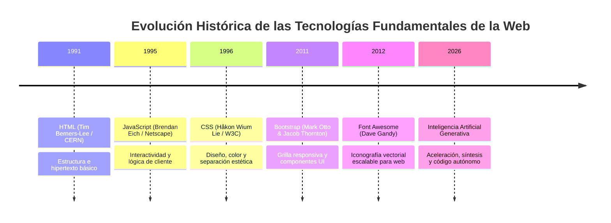

# MANUAL UNIVERSITARIO Y TUTORIAL MAESTRO DE DESARROLLO E-COMMERCE CON INTELIGENCIA ARTIFICIAL

---

## 1. PORTADA OFICIAL

```
========================================================================================
                                   UNIVERSIDAD CENTRAL
                       FACULTAD DE INGENIERÍA Y CIENCIAS APLICADAS
                        ESCUELA DE DESARROLLO DE SOFTWARE Y TIC
========================================================================================

ASIGNATURA:
Desarrollo de Aplicaciones Web y Comercio Electrónico con Inteligencia Artificial

TÍTULO DEL PROYECTO:
PROYECTO BÁSICO PERO FUNDAMENTAL DE INTELIGENCIA ARTIFICIAL APLICADA EN EL DESARROLLO 
DE E-COMMERCE: SHOPMASTER 🛒 - CÓMO COMENZAR A CREAR TIENDAS DIGITALES Y MONETIZAR DESDE EL NAVEGADOR

ESTUDIANTE:
[Nombre y Apellidos del Estudiante]
Matrícula / ID: [0000-0000]

DOCENTE / PROFESOR:
Ing. Juancito Peña

FECHA DE ENTREGA:
26 de Octubre de 2026

ENLACES DE PRODUCCIÓN Y CÓDIGO FUENTE:
- Repositorio GitHub: https://github.com/[TU_USUARIO]/shopmaster-ecommerce-ia
- Despliegue en GitHub Pages: https://[TU_USUARIO].github.io/shopmaster-ecommerce-ia/
- Despliegue en Vercel: https://shopmaster-ecommerce-ia.vercel.app/
========================================================================================
```

---

## 2. INTRODUCCIÓN

### 2.1 Breve Descripción del Proyecto
El presente proyecto consiste en el diseño, desarrollo e implementación de una tienda virtual moderna, responsiva y funcional denominada **ShopMaster 🛒**. La aplicación consume en tiempo real el catálogo de la API pública **FakeStore** (`https://fakestoreapi.com/products`), organizando los productos en tarjetas interactivas categorizadas. Cuenta con una ventana modal de visualización ampliada con selector de cantidades, un carrito de compras reactivo con persistencia local en `LocalStorage`, una pasarela de pago simulada con validación de tarjetas bancarias y un motor integrado de generación de **tickets fiscales térmicos en formato PDF (80 mm)** utilizando la biblioteca `jsPDF`.

### 2.2 Objetivos Principales
1. **Democratizar el acceso al desarrollo web comercial:** Demostrar cómo una persona sin conocimientos profundos de programación puede, asistida por herramientas de Inteligencia Artificial (Google Gemini, Grok, ChatGPT, Claude, DeepSeek), estructurar una solución web profesional en pocas horas.
2. **Dominar la integración de tecnologías cliente esenciales:** Implementar HTML5 para estructura semántica, CSS3 para estilizado con psicología de color, JavaScript ES6+ para manipulación reactiva del DOM y llamadas asíncronas con Fetch API.
3. **Incorporar persistencia y hardware de punto de venta (POS):** Almacenar los datos de compra en el navegador y generar un comprobante imprimible con dimensiones y tipografía monoespaciada exacta para impresoras térmicas de caja registradora.
4. **Desplegar en la nube de forma gratuita:** Publicar la plataforma en entornos de producción globales (GitHub Pages y Vercel) mediante flujos visuales sin requerir comandos de consola.

### 2.3 Importancia del Proyecto en la Economía Digital
El comercio electrónico ha dejado de ser un privilegio de corporaciones multimillonarias. La convergencia entre APIs abiertas y modelos de lenguaje de Inteligencia Artificial permite a emprendedores y desarrolladores independientes prototipar, validar y monetizar tiendas digitales a una fracción del costo tradicional. Este proyecto representa la base fundacional para comercializar plantillas, prestar servicios a negocios locales o convertir la aplicación web en una solución móvil utilizando tecnologías híbridas.

---

## 3. MARCO TEÓRICO E HISTÓRICO: FUNDAMENTOS DEL DESARROLLO WEB

Para comprender cabalmente cómo funciona la plataforma, es fundamental analizar las tecnologías web en su contexto de evolución cronológica:



### 3.1 ¿Qué es la Programación Web?
La programación web es el proceso de creación, estructuración y programación de sitios y aplicaciones que se ejecutan a través de navegadores web (como Google Chrome, Mozilla Firefox o Safari) y se comunican mediante el protocolo HTTP/HTTPS. Se divide en dos mundos complementarios:
- **Frontend (Lado del Cliente):** Todo lo que el usuario ve, toca y experimenta directamente en su pantalla (estructura, estilos, animaciones, validaciones de formularios y procesamiento de eventos).
- **Backend (Lado del Servidor):** Los motores de base de datos, lógica de autenticación y servidores que alimentan los datos.

En nuestro proyecto, la arquitectura es **Frontend Jamstack**: una interfaz autónoma y ultra veloz que consume directamente un backend desacoplado a través de una API RESTful pública.

### 3.2 Evolución de las Tecnologías Utilizadas

#### 1. HTML (HyperText Markup Language) — 1991
- **Origen:** Creado por Tim Berners-Lee en el CERN (Suiza) para compartir documentos científicos mediante hipervínculos.
- **Función:** Es el esqueleto de la web. Define las etiquetas (`<header>`, `<nav>`, `<main>`, `<section>`, `<article>`, `<button>`, `<modal>`) que indican al navegador qué elementos existen en la página.
- **Uso en el Proyecto:** Estructura semántica completa del catálogo, tarjetas de productos, modales interactivos y formularios de pago.

#### 2. JavaScript (JS) — 1995
- **Origen:** Creado por Brendan Eich en tan solo 10 días para Netscape Navigator bajo el nombre inicial de *Mocha*, luego rebautizado como *LiveScript* y finalmente *JavaScript*.
- **Función:** Es el cerebro y sistema nervioso de la web. Permite dotar de dinamismo a las páginas, reaccionar a clics, consultar servidores sin recargar la pantalla (`fetch`) y almacenar datos locales.
- **Uso en el Proyecto:** Consumo asíncrono de la FakeStore API, lógica del carrito de compras, persistencia en `LocalStorage`, validación de tarjetas de crédito y ensamblado matemático del PDF en `jsPDF`.

#### 3. CSS (Cascading Style Sheets) — 1996
- **Origen:** Propuesto por Håkon Wium Lie y promovido por el consorcio W3C para resolver un problema crítico: separar la presentación visual del contenido estructural.
- **Función:** Es la piel y vestimenta de la web. Controla colores, tipografías, márgenes, bordes, sombras, rejillas (`CSS Grid`), cajas flexibles (`Flexbox`) y transiciones animadas.
- **Uso en el Proyecto:** Aplicación estricta de la psicología del color, sombras de elevación al pasar el cursor (`hover effects`), animaciones de entrada y tipografías legibles.

#### 4. Bootstrap — 2011
- **Origen:** Creado originalmente por Mark Otto y Jacob Thornton dentro de Twitter como un estándar interno ("Twitter Blueprint") y luego liberado como código abierto en agosto de 2011.
- **Función:** Es el framework CSS y de componentes más popular del mundo. Introdujo el concepto de diseño responsivo *Mobile-First* basado en una cuadrícula flexible de 12 columnas.
- **Uso en el Proyecto:** Se utilizó **Bootstrap 5.3.3** para la grilla adaptativa de productos, los modales emergentes accesibles, el panel lateral retráctil (`Offcanvas`) del carrito y los indicadores de carga (`spinners`).

#### 5. Font Awesome — 2012
- **Origen:** Diseñado por Dave Gandy para acompañar proyectos que necesitaban iconografía vectorial nítida que no perdiera calidad en pantallas de alta densidad (Retina Display).
- **Función:** Proporciona miles de iconos vectoriales escalables administrables mediante clases CSS (color, tamaño, rotación).
- **Uso en el Proyecto:** Iconos interactivos en toda la tienda: carrito (`fa-cart-shopping`), lupa de búsqueda (`fa-magnifying-glass`), estrellas de calificación (`fa-star`), marcas de tarjetas de crédito (`fa-cc-visa`, `fa-cc-mastercard`) y candados de seguridad SSL (`fa-lock`).

---

## 4. GUÍA PASO A PASO DEL PROYECTO: CÓDIGO Y ESTRUCTURA

### 4.1 Estructura de Carpetas del Proyecto
Para garantizar la separación limpia de responsabilidades (Clean Architecture en Frontend), el proyecto se divide en 3 archivos independientes:

```
E-Commerce_ShopMaster_IA/
│
├── index.html    (Estructura y semántica)
├── styles.css    (Diseño, variables y animación)
└── app.js        (Lógica de negocio, API y PDF)
```

### 4.2 Desglose del Código Fuente Comentado

#### Archivo 1: `index.html` (Estructura Semántica)
- **Cabecera (`<head>`):** Importa la fuente oficial *Roboto* de Google Fonts, la hoja de estilos de Bootstrap 5 vía CDN, la biblioteca de iconos Font Awesome 6 y nuestra hoja personalizada `styles.css`.
- **Navbar:** Barra de navegación fija superior (`sticky-top`) en azul eléctrico (`bg-electric`) con logotipo `ShopMaster`, buscador en tiempo real y botón de carrito con un *badge* dinámico que refleja la cantidad de artículos acumulados.
- **Hero Banner:** Mensaje de bienvenida con botones de llamado a la acción (*Call to Action*).
- **Sección de Catálogo (`#catalogo`):** Filtros por categoría (Todos, Ropa Hombre, Ropa Mujer, Joyería, Electrónica), spinner animado de carga y la cuadrícula responsiva `#productsGrid`.
- **Modal de Detalle (`#productDetailModal`):** Ventana emergente con imagen ampliada centrada, estrellas de rating, descripción extendida, selector de cantidad `+ / -` y botón de añadir al carrito.
- **Offcanvas de Carrito (`#cartOffcanvas`):** Menú lateral deslizante que lista los productos seleccionados, permite modificar cantidades o eliminarlos, calcula el subtotal, impuestos (18%) y total final, y da paso al checkout.
- **Modal de Pasarela de Pago (`#checkoutModal`):** Formulario con validación visual para nombre del titular, número de tarjeta de 16 dígitos con formateo automático, fecha de expiración MM/AA y código CVV.
- **Modal de Confirmación y Recibo Térmico (`#receiptModal`):** Muestra el mensaje de éxito y la vista previa del comprobante en tipografía Courier, con botón para descargar el ticket térmico en formato PDF de 80 mm.
- **Scripts al final del `<body>`:** Se cargan Bootstrap Bundle JS, la biblioteca `jsPDF` (versión 2.5.1) y nuestro script principal `app.js`.

#### Archivo 2: `styles.css` (Psicología del Color y Experiencia de Usuario)
- **Paleta de Colores Estratégica:**
  - **Azul Eléctrico (`#007BFF`):** Transmite seguridad, solvencia y confianza en la marca.
  - **Verde Éxito (`#28A745`):** Induce a la acción positiva de compra, checkout y confirmación.
  - **Blanco (`#FFFFFF`):** Proporciona sensación de amplitud, pulcritud y claridad visual.
  - **Gris Oscuro (`#343A40`):** Asegura contraste óptimo contra fondo blanco cumpliendo estándares de accesibilidad WCAG 2.2 AA.
- **Efectos Microinteractivos:** Elevación suave de las tarjetas al colocar el ratón encima (`translateY(-6px)`), zoom sutil sobre la imagen del producto (`transform: scale(1.08)`) y sombras multicapa suaves.
- **Tipografía Monoespaciada (`Courier Prime`):** Utilizada exclusivamente en la vista previa del recibo térmico para emular el papel continuo de las cajas registradoras físicas.

#### Archivo 3: `app.js` (Lógica Reactiva, API, Persistencia y jsPDF)
- **Consumo Asíncrono (`fetchProducts`):** Emplea `async/await` para conectarse a `https://fakestoreapi.com/products`. Si la conexión es exitosa, procesa el JSON recibido; si hay un corte de red, despliega un contenedor de alerta amigable con opción de reintentar.
- **Filtrado y Búsqueda Reactiva:** Permite buscar productos por texto (título, descripción o categoría) y filtrar por botones temáticos instantáneamente sin recargar la página.
- **Persistencia en `LocalStorage`:** Cada adición, modificación de cantidad o eliminación de ítems se serializa mediante `JSON.stringify()` en la clave `shopmaster_cart_v1`. Al abrir la página de nuevo, el carrito se restaura automáticamente con `JSON.parse()`.
- **Motor de Generación de Ticket Térmico con jsPDF:**
  - Crea un documento con ancho físico de **80 mm** (norma universal de impresoras térmicas POS de punto de venta).
  - Calcula la altura dinámica en milímetros en función del número de artículos comprados, evitando hojas en blanco innecesarias.
  - Establece la fuente en `courier`, tamaño de 9 puntos.
  - Escribe el encabezado comercial, RNC fiscal, número de ticket autogenerado (`TKT-2026-XXXX`), desglose tabulado de ítems con cantidades y precios, subtotal, impuestos del 18% y total general.
  - Ejecuta la descarga automática con `doc.save('Ticket_ShopMaster_XXXXXX.pdf')`.

---

## 5. GUÍA PRÁCTICA: CÓMO TRABAJAR EN VISUAL STUDIO CODE Y LIVE SERVER

Esta sección está especialmente diseñada para estudiantes que abren Visual Studio Code por primera vez.

### 5.1 Creación y Organización de Archivos en la Computadora
1. Abre tu computadora y ve al **Escritorio**.
2. Haz clic derecho en un espacio vacío, selecciona **Nuevo > Carpeta** y nómbrala exactamente:  
   `E-Commerce_ShopMaster_IA`
3. Abre **Visual Studio Code**.
4. En el menú superior, ve a **File (Archivo) > Open Folder... (Abrir Carpeta...)**.
5. Selecciona la carpeta que acabas de crear en el Escritorio y presiona **Seleccionar carpeta**.
6. En el panel izquierdo de VS Code (Explorador de Archivos), haz clic en el icono de **Nuevo Archivo** (una hoja con un signo más) y crea los 3 archivos:
   - `index.html`
   - `styles.css`
   - `app.js`
7. Pega en cada uno el código correspondiente y guarda los cambios con `Ctrl + S`.

### 5.2 ¿Qué es Live Server y Cómo Instalarla?
**Live Server** es una extensión imprescindible para desarrollo web. Levanta un servidor local en tu equipo y recarga automáticamente la página en el navegador cada vez que guardas un cambio en tu código HTML, CSS o JS, eliminando la necesidad de presionar `F5` constantemente.

#### Paso a Paso para Instalar Live Server:
1. En la barra lateral izquierda de Visual Studio Code, haz clic en el icono de **Extensiones** (un bloque de 4 cuadrados donde uno se desprende) o presiona el atajo `Ctrl + Shift + X`.
2. En la barra de búsqueda superior, escribe:  
   `Live Server`
3. Busca la extensión desarrollada por el autor **Ritwick Dey** (tiene millones de descargas y un icono morado con una señal de radio).
4. Haz clic en el botón azul **Install (Instalar)**. En 5 segundos estará lista.

#### Cómo Usar Live Server:
- **Método 1:** Abre el archivo `index.html` en tu editor, haz clic derecho sobre el código y selecciona **Open with Live Server**.
- **Método 2:** En la esquina inferior derecha de la ventana de Visual Studio Code, haz clic en el botón que dice **Go Live**.
- Se abrirá automáticamente tu navegador predeterminado en la dirección local:  
  `http://127.0.0.1:5500/index.html`

---

## 6. GUÍA DE DESPLIEGUE EN GITHUB Y GITHUB PAGES (MÉTODO SIN CONSOLA: DRAG & DROP)

Esta guía explica paso a paso cómo publicar el proyecto en Internet sin tener que escribir comandos en una terminal.

### 6.1 Paso 1: Crear una Cuenta en GitHub
1. Entra en tu navegador a: [https://github.com/](https://github.com/).
2. En la esquina superior derecha, haz clic en **Sign up (Registrarse)**.
3. Introduce tu dirección de correo electrónico, define una contraseña segura y escribe un nombre de usuario (*username*).
4. Resuelve el breve acertijo de verificación visual para comprobar que eres humano.
5. GitHub enviará un código de verificación de 8 dígitos a tu correo electrónico. Cópialo y pégalo en la pantalla.
6. ¡Listo! Tu cuenta en GitHub ha sido creada exitosamente.

### 6.2 Paso 2: Crear el Repositorio del Proyecto
1. Una vez dentro de GitHub, haz clic en el botón verde **New (Nuevo)** en el panel izquierdo, o en el icono `+` de la barra superior y selecciona **New repository**.
2. Completa los siguientes campos:
   - **Repository name:** `shopmaster-ecommerce-ia` (usa minúsculas y guiones, sin espacios).
   - **Description:** `Tienda virtual con FakeStore API, carrito LocalStorage y ticket térmico en PDF`.
   - **Public / Private:** Selecciona **Public** (Obligatorio para que GitHub Pages sea gratuito).
   - **Initialize this repository with:** Marca la casilla **Add a README file**.
3. Baja hasta el final y haz clic en el botón verde **Create repository**.

### 6.3 Paso 3: Subir los Archivos Arrastrando y Soltando (Drag & Drop)
1. En la página de tu nuevo repositorio, haz clic en el botón **Add file** (Agregar archivo) y selecciona **Upload files (Subir archivos)**.
2. Abre la ventana del explorador de Windows donde tienes tu carpeta `E-Commerce_ShopMaster_IA`.
3. Selecciona los archivos:
   - `index.html`
   - `styles.css`
   - `app.js`
4. Arrástralos con el ratón y suéltalos dentro del cuadro que dice **"Drag files here to add them to your repository"**.
5. Espera a que la barra de subida complete el 100%.
6. En la parte inferior, en el cuadro de texto de *Commit changes*, escribe:  
   `Versión inicial de ShopMaster con Carrito y jsPDF`
7. Haz clic en el botón verde **Commit changes**. Todos los archivos quedarán guardados en tu repositorio.

### 6.4 Paso 4: Activar GitHub Pages y Obtener la URL Pública
1. En el menú superior de pestañas de tu repositorio, haz clic en **Settings (Configuración)**.
2. En la columna izquierda, busca la sección **Code and automation** y haz clic en **Pages**.
3. En la sección **Build and deployment > Source**, asegúrate de que esté seleccionado **Deploy from a branch**.
4. Debajo, en **Branch**:
   - Cambia `None` por **main** (o `master`).
   - Deja la carpeta en `/ (root)`.
   - Haz clic en el botón **Save (Guardar)**.
5. Espera entre 1 y 2 minutos mientras los servidores de GitHub compilan tu página web.
6. Recarga la página (`F5`). Aparecerá un recuadro verde que dice:  
   `Your site is live at https://[TU_USUARIO].github.io/shopmaster-ecommerce-ia/`
7. Haz clic en el enlace para verificar que la tienda funcione en vivo en Internet.

---

## 7. GUÍA DE PUBLICACIÓN EN VERCEL (ENLACE DIRECTO CON GITHUB)

Vercel es la plataforma de despliegue en la nube más rápida y utilizada por la industria del software. Ofrece servidores CDN distribuidos por todo el planeta, certificados SSL automáticos y despliegue continuo.

### 7.1 Paso 1: Crear una Cuenta en Vercel
1. Ingresa en tu navegador a: [https://vercel.com/](https://vercel.com/).
2. En la esquina superior derecha, haz clic en **Sign Up**.
3. Selecciona el tipo de cuenta **Hobby (Personal)** e introduce tu nombre.
4. Haz clic en el botón **Continue with GitHub**.
5. Vercel te solicitará autorización para conectarse con tu cuenta de GitHub. Haz clic en **Authorize Vercel**.

### 7.2 Paso 2: Importar y Desplegar el Proyecto
1. Al iniciar sesión en tu panel de control de Vercel (*Dashboard*), haz clic en el botón azul **Add New... > Project**.
2. Verás una lista con todos tus repositorios de GitHub. Localiza el repositorio:  
   `shopmaster-ecommerce-ia`
3. Haz clic en el botón **Import** situado a la derecha del repositorio.
4. En la pantalla de configuración (*Configure Project*):
   - **Project Name:** Puedes dejar `shopmaster-ecommerce-ia`.
   - **Framework Preset:** Déjalo en `Other` (ya que es HTML/CSS/JS puro).
   - **Root Directory:** Déjalo en `./`.
5. Haz clic en el botón azul **Deploy**.
6. Vercel tardará unos 15 a 25 segundos en procesar tu aplicación. Al terminar, verás confeti digital en tu pantalla con el mensaje **"Congratulations! You just deployed a new project to Vercel."**

### 7.3 Paso 3: Visualizar y Compartir la URL
- Haz clic en la captura de pantalla en miniatura o en el botón **Continue to Dashboard**.
- En la sección **Domains**, verás tu URL oficial, similar a:  
  `https://shopmaster-ecommerce-ia.vercel.app/`
- Copia este enlace para compartirlo con tu docente, clientes o compañeros.

---

## 8. ANÁLISIS MÉTRICO DE RENDIMIENTO: TIEMPOS SEGÚN PERFIL DE DESARROLLADOR

A continuación se presenta el estudio comparativo exhaustivo que analiza el tiempo que tomaría construir este proyecto en su totalidad (investigación, diseño visual, maquetación, conexión con API, desarrollo del carrito, pasarela simulada, cálculo de impuestos, formateo de ticket en jsPDF, pruebas y despliegue), comparando el desarrollo tradicional manual frente al desarrollo acelerado con Inteligencia Artificial.

### 📊 Tabla de Métricas (Lista para Copiar y Pegar en Microsoft Excel)

| Nivel de Experiencia | Modalidad de Trabajo | Tiempo Tradicional (Sin IA) | Tiempo Acelerado (Con IA) | Ahorro de Tiempo (%) | Costo Estimado Tradicional ($USD) | Costo Estimado con IA ($USD) | Factor Clave de Aceleración con IA |
| :--- | :--- | :--- | :--- | :--- | :--- | :--- | :--- |
| **Aprendiz / Estudiante** | Proyecto Autónomo / Tarea | 45 horas (1-2 semanas) | 3.5 horas | 92.2% | $0 (Académico) | $0 (Académico) | Explicación instantánea de conceptos, generación de sintaxis de jsPDF y depuración sin frustración. |
| **Aprendiz / Estudiante** | Pasantía en Empresa | 38 horas | 4.0 horas | 89.5% | $380 USD ($10/h) | $40 USD | Superación de bloqueos técnicos y estructuración rápida de la rejilla responsiva. |
| **Junior Developer** | Empresa de Software | 24 horas (3 días) | 2.5 horas | 89.6% | $480 USD ($20/h) | $50 USD | Automatización del código repetitivo (*boilerplate*), eventos del DOM y validaciones de tarjeta. |
| **Junior Developer** | Freelance / Independiente | 28 horas | 3.0 horas | 89.3% | $700 USD ($25/h) | $75 USD | Entrega ágil de propuesta funcional con diseño visual profesional listo para el cliente. |
| **Senior Developer** | Empresa de Software | 10 horas | 1.2 horas | 88.0% | $600 USD ($60/h) | $72 USD | Enfoque exclusivo en arquitectura y calidad; la IA redacta el CSS y los cálculos de milímetros de jsPDF. |
| **Senior Developer** | Freelance / Consultor | 12 horas | 1.5 horas | 87.5% | $960 USD ($80/h) | $120 USD | Capacidad de cotizar entregables rápidos con márgenes de rentabilidad significativamente mayores. |
| **Experto Full Stack** | Tech Lead Corporativo | 7 horas | 45 minutos (0.75 h) | 89.3% | $700 USD ($100/h) | $75 USD | Validación técnica inmediata, revisión de contratos JSON y despliegue continuo instantáneo. |
| **Experto Full Stack** | Freelancer / Agencia Digital | 8 horas | 50 minutos (0.83 h) | 89.6% | $960 USD ($120/h) | $100 USD | Creación de productos mínimos viables (MVP) en el mismo día para validación comercial con usuarios reales. |

---

## 9. CONCLUSIÓN Y REFLEXIÓN PERSONAL

### 9.1 Reflexión sobre la Experiencia del Proyecto
Desarrollar la tienda virtual **ShopMaster** ha marcado un hito en mi proceso de formación académica y profesional. Enfrentar el reto de construir una aplicación completa —que no solo se ve atractiva sino que interactúa con datos en vivo de una API externa, recuerda los productos agregados mediante `LocalStorage` y es capaz de calcular y emitir un recibo térmico con estándares fiscales en PDF— me permitió unir la teoría abstracta del aula con una solución aplicable a negocios del mundo real.

La experiencia confirmó que la programación no se trata únicamente de memorizar etiquetas o métodos de memoria, sino de comprender la arquitectura del sistema, la lógica del flujo de datos y la empatía con el usuario final. Diseñar bajo la psicología del color y cuidar la adaptabilidad móvil demostró que la experiencia de usuario (UX) es tan determinante para el éxito comercial como el código interno que procesa la compra.

### 9.2 Impacto Personal y Visión de Futuro
A partir de hoy, este proyecto cambia radicalmente mi perspectiva laboral. Lo que antes percibía como un proceso largo y reservado únicamente para ingenieros con décadas de experiencia, hoy es una competencia que puedo poner al servicio de mi comunidad. Con este código base tengo la capacidad de:
1. Ofrecer digitalización y catálogos virtuales a pequeños comercios y colmados locales que aún registran sus ventas en cuadernos manuales.
2. Construir mi portafolio digital para postulaciones laborales demostrando proyectos desplegados en producción real.
3. Extender la solución hacia aplicaciones móviles nativas o conectar pasarelas de pago transaccionales como Stripe o PayPal.

### 9.3 El Poder de Aprender Cualquier Habilidad en la Era de la Inteligencia Artificial
La lección más trascendental de este trabajo no radica únicamente en HTML o JavaScript, sino en la metamorfosis del aprendizaje en sí mismo. En la era digital, la Inteligencia Artificial actúa como un mentor personalizado disponible las 24 horas del día. Un aprendiz con disciplina y curiosidad ya no está limitado por la falta de un tutor presencial: la IA le enseña la lógica, le explica los errores de sintaxis y le ayuda a convertir una idea abstracta en un producto funcional.

La habilidad más valiosa del siglo XXI ya no es almacenar conocimientos estáticos, sino desarrollar el pensamiento crítico, la capacidad de formular preguntas precisas (*Prompt Engineering*) y la perseverancia para iterar soluciones hasta alcanzar la excelencia.

---

## 10. BIBLIOGRAFÍA Y RECURSOS UTILIZADOS

1. **FakeStore API (2024):** *Fake Store REST API for e-commerce or shopping website prototype*. Documentación oficial: [https://fakestoreapi.com/](https://fakestoreapi.com/).
2. **Mozilla Developer Network (MDN Web Docs):** *Guía completa de JavaScript ES6+, Fetch API y Web Storage API (LocalStorage)*. [https://developer.mozilla.org/es/](https://developer.mozilla.org/es/).
3. **Bootstrap Documentation (v5.3):** *The most popular HTML, CSS, and JS library in the world*. [https://getbootstrap.com/docs/5.3/](https://getbootstrap.com/docs/5.3/).
4. **jsPDF Library Documentation:** *Client-side JavaScript PDF generation for everyone by ParMetaData*. [https://rawgit.com/MrRio/jsPDF/master/docs/](https://rawgit.com/MrRio/jsPDF/master/docs/).
5. **W3C (World Wide Web Consortium):** *Web Content Accessibility Guidelines (WCAG) 2.2*. [https://www.w3.org/TR/WCAG22/](https://www.w3.org/TR/WCAG22/).
6. **Herramientas de Inteligencia Artificial Empleadas:**
   - **Google Gemini (Gemini 2.5 Pro / 3.8 Flash):** Asistencia en arquitectura de software, refinamiento de prompts y optimización del código de cálculo térmico.
   - **ChatGPT (OpenAI) & Claude (Anthropic):** Consulta y contraste de pedagogía web y estándares de accesibilidad visual.

---

## 11. INSTRUCCIONES PARA GUARDAR EL DOCUMENTO EN WORD (.DOCX) Y EXPORTAR A PDF (.PDF)

Sigue estos pasos para entregar tu asignación universitaria con acabado profesional:

### 11.1 Cómo Crear y Guardar el Documento en Microsoft Word (.docx)
1. Abre **Microsoft Word** en tu computadora y selecciona **Documento en blanco**.
2. Copia todo el contenido de este manual (desde el título y la portada hasta la bibliografía).
3. Pega el texto en Word utilizando la opción **Mantener formato de origen** o **Combinar formato**.
4. Aplica los estilos visuales:
   - Portada centrada en la primera página.
   - Títulos en fuente **Arial** o **Calibri**, tamaño 16 pt y en color azul institucional (`#007BFF`).
   - Texto de párrafos en tamaño 11 pt con interlineado de 1.15.
   - Pega las capturas de pantalla de tu tienda funcionando, de Visual Studio Code y de tus páginas de GitHub y Vercel en la sección de Desarrollo.
   - Copia la tabla métrica directamente: en Word se convertirá automáticamente en una tabla editable donde puedes colorear el encabezado en azul y las filas alternadas.
5. Haz clic en **Archivo** en la barra superior.
6. Selecciona **Guardar como** y busca la carpeta de tu trabajo.
7. En el campo **Tipo de archivo**, selecciona **Documento de Word (*.docx)**.
8. Nómbralo: `Proyecto_Final_E-Commerce_IA_[TuNombre].docx` y haz clic en **Guardar**.

### 11.2 Cómo Exportar el Documento a PDF (.pdf)
1. Con tu documento abierto y completamente revisado en Microsoft Word.
2. Haz clic en la pestaña superior **Archivo**.
3. En el menú lateral, selecciona **Exportar**.
4. Haz clic en el botón que dice **Crear documento PDF/XPS**.
5. Elige la carpeta donde guardarás el archivo.
6. Verifica que la casilla de optimización esté en **Estándar (publicación en línea e impresión)** para conservar la nitidez de las capturas de pantalla.
7. Haz clic en el botón **Publicar**.
8. Se generará tu archivo PDF listo para ser cargado en el portal de la universidad.
